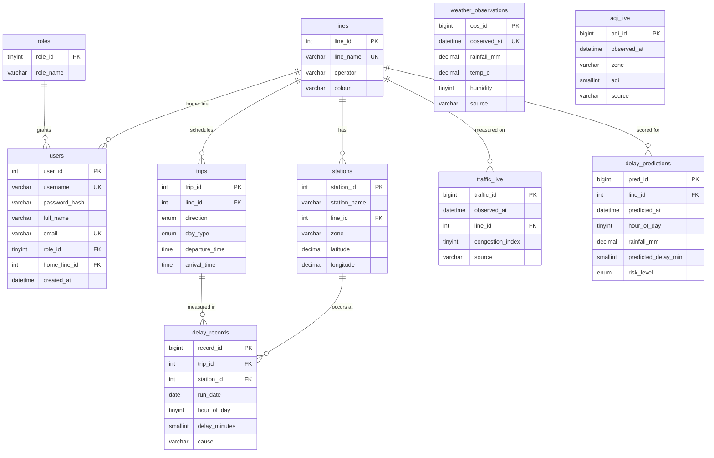

# Entity-Relationship Diagram

## Notes

- `stations` has a unique key on `(station_name, line_id)`, so interchange
  stations like **Dadar** and **Kurla** appear once per line they serve.
- `delay_records` is the central fact table: one row = one trip measured at one
  station on one date.
- `weather_observations` is unique per hour, which makes the ETL a safe upsert.
- Views (`v_line_reliability`, `v_monsoon_impact`, `v_delay_by_hour`,
  `v_station_hotspots`, `v_daily_weather`, `v_latest_risk`) sit on top of these
  tables and are what the app queries.
